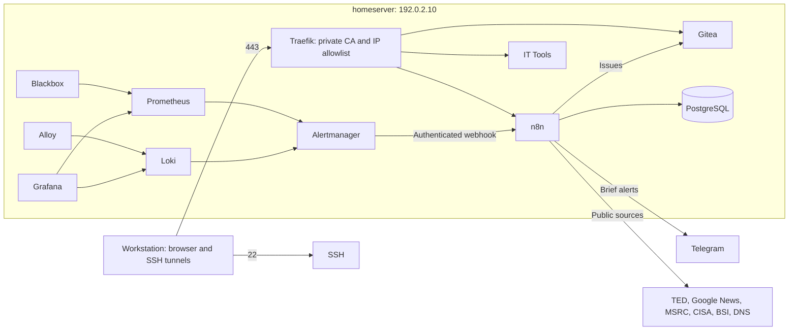

# Homelab operating handbook

**Public configuration template.**

This handbook describes the example stack. All host addresses and account names are placeholders; configure them for your own environment before deploying. Keep operational schedules, internal findings and live infrastructure details outside the public repository.

## Overview

| Item | Example configuration |
|---|---|
| Host | `homeserver`, Ubuntu VM in VMware Workstation on the workstation PC |
| Address | `192.0.2.10` (placeholder), server network separated from Wi-Fi/mobile clients |
| Access | SSH keys, user `<admin-user>`, password-protected sudo |
| Inbound ports | 22 for SSH, 80 redirecting to 443, 443 for Traefik |
| Configuration | `~/docker`, your own private deployment repository |
| Notifications | Brief Telegram messages without sensitive details; detailed records in Gitea issues |



## Services

| Service | Access | Purpose |
|---|---|---|
| n8n | `https://n8n.<DOMAIN>` | Automation |
| Gitea | `https://gitea.<DOMAIN>` | Private issue tracking |
| IT Tools | `https://tools.<DOMAIN>` | Utilities |
| Traefik dashboard | `https://traefik.<DOMAIN>` | Authenticated administration |
| Homepage | Tunnel to `http://localhost:3000` | Start page |
| Portainer | Tunnel to `https://localhost:9443` | Docker administration |
| Uptime Kuma | Tunnel to `http://localhost:3001` | Availability |
| Grafana | Tunnel to `http://localhost:3002` | Dashboards and logs |
| Prometheus / Alertmanager | Tunnels to 9090 / 9093 | Metrics and alerts |

Configure an SSH tunnel profile for the loopback interfaces. Browsers must trust the private homelab CA, which is restricted to `*.<DOMAIN>` by a name constraint (see [Certificates](#certificates)).

## Local configuration

The scripts and Compose files read host-specific values instead of hard-coding them:

| Value | Where it is set | Used by |
|---|---|---|
| `DOMAIN`, `LAN_IP`, `LAN_CIDR` | `traefik/.env` | Traefik labels and allowlist, `homeserver-check.sh` |
| `DOMAIN` | `gitea/.env`, `it-tools/.env`, `n8n/.env` | Router rules and service URLs |
| `HOMEPAGE_VAR_DOMAIN` | `homepage/.env` | Links in `homepage/config/services.yaml` |
| Probe targets | `monitoring/prometheus/targets/extern.yml`, `intern.yml` | Certificate and availability probes |
| `ADMIN_USER` | Environment, defaults to the user who invoked `sudo` | All scripts under `scripts/` |

Copy each `.env.example` and `targets/*.yml.example` file, then replace the placeholders. These local files are excluded from Git.

## Certificates

Traefik serves a wildcard certificate signed by a private CA. Certificates and keys are generated on the server and are not stored in Git. With `DOMAIN` set to the value from `traefik/.env`:

```bash
cd ~/docker/traefik
export DOMAIN=192.0.2.10.nip.io
openssl req -x509 -new -nodes -newkey rsa:4096 -sha256 -days 3650 \
  -config ca/ca.cnf -keyout ca/ca.key -out ca/ca.crt
openssl req -new -nodes -newkey rsa:2048 -subj "/CN=*.$DOMAIN" \
  -keyout certs/wildcard.key -out certs/wildcard.csr
openssl x509 -req -in certs/wildcard.csr -CA ca/ca.crt -CAkey ca/ca.key -CAcreateserial \
  -days 825 -sha256 -extfile certs/wildcard.ext -out certs/wildcard.crt
cp ca/ca.crt ../blackbox/config/ca.crt
chmod 600 ca/ca.key certs/wildcard.key
```

Import `ca/ca.crt` into the browsers that access the services.

## Security configuration

- SSH keys only, no root login, fail2ban. `/etc/ssh/sshd_config.d/00-keyonly.conf` takes precedence over `50-cloud-init.conf`.
- UFW blocks inbound traffic except 22/80/443; container ports bind to loopback.
- Unattended security updates and `/etc/sysctl.d/99-hardening.conf`.
- Traefik uses TLS 1.2+, response headers, authenticated dashboard access, and a block for n8n `/metrics` in `traefik/dynamic/n8n-metrics-block.yml`.
- Webhooks require a token. `.env` files use mode 600 and are excluded from Git. Images are pinned by digest.

## Routine operations

| Frequency | Task | Location or command |
|---|---|---|
| Daily 03:15 | Automatic backup | `/usr/local/sbin/homeserver-backup.sh`; log `/var/backups/homelab/<admin-user>/backup.log` (read with sudo) |
| Weekly | Health/configuration check | `sudo bash ~/docker/scripts/homeserver-check.sh` |
| Monthly | Deliberate image updates | Update runbook below |
| When required | Reboot after a kernel update | `sudo reboot`; VM services start automatically |

## Weekly check

```bash
sudo bash ~/docker/scripts/homeserver-check.sh | grep -E '\[(FAIL|WARN)\]|OK:'
```

Expected result: `FAIL: 0`. The existing `--fix` option handles the script's defined corrections, including SSH configuration, permissions, and the metrics block. Full reports are stored in `/var/log/homelab/<admin-user>/`, owned by root and read with `sudo`.

## Update a service

1. Check the backup: `sudo ls /var/backups/homelab/<admin-user>/`.
2. Set the intended version in the Compose file's `image:` entry after reviewing the update.
3. In `~/docker/<service>`, run `sudo docker compose pull` and `sudo docker compose up -d`.
4. Check `sudo docker ps`, the web interface, and a representative n8n workflow where applicable.
5. Run `bash ~/docker/scripts/pin-images.sh --apply` and commit the resulting digest update.

Rollback: recover the previous `image:` value from `git log -p <file>` and run `docker compose up -d` for that service.

## Restore n8n

Use the intended backup date and verify its checksums before restoring:

```bash
sudo -i
cd /var/backups/homelab/<admin-user>/<timestamp-random>
sha256sum -c SHA256SUMS
sudo docker stop n8n
sudo docker exec -i n8n-db sh -c 'pg_restore -U "$POSTGRES_USER" -d "$POSTGRES_DB" --clean --if-exists' < n8n-db.dump
sudo tar -xzf n8n.tar.gz -C /
cd ~/docker/n8n
sudo docker compose up -d
```

Backups and their ancestors stay root-owned; each run creates a fresh directory. Do not move privileged backup output into a home directory or make these directories writable by other users. Export offsite copies through an approved privileged backup process and encrypt them.

The archive includes the data directory and encryption key. Stored credentials cannot be decrypted without the matching key from the backup or `n8n/.env`.

## Troubleshooting

| Symptom | Likely cause | Check |
|---|---|---|
| Compose configuration differs | File changed but the container still uses its previous configuration | Review `git diff` and `git log -p`, then intentionally recreate the service |
| Docker socket permission denied | `<admin-user>` is deliberately outside the `docker` group | Use the documented sudo commands |
| SSH tunnel connection failed | Stopped service or outdated forwarded port | Check the service and SSH profile, then restart the tunnel |
| SSH password authentication reappears | Cloud-init regenerated its configuration | Check `00-keyonly.conf` and the check script's findings |
| Telegram notifications stop | Unpublished workflow or changed token | Review the workflow and its published state in n8n |

